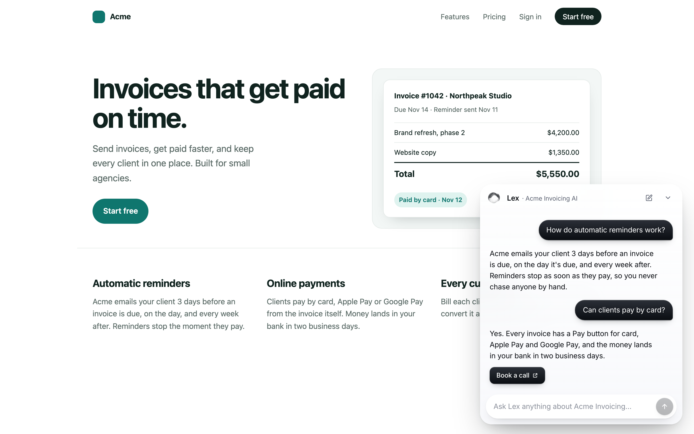
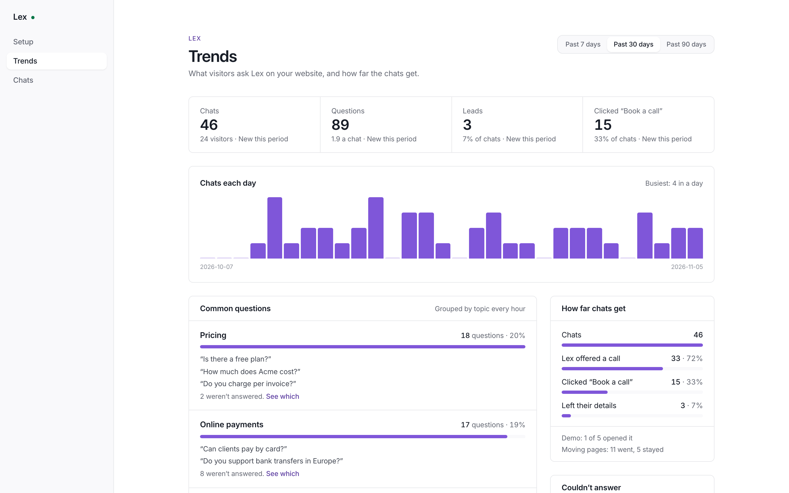
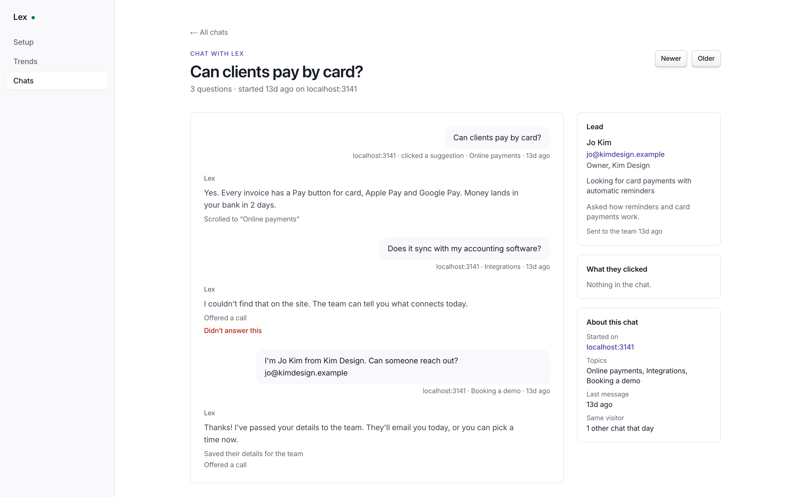

<p align="center">
  <picture>
    <source media="(prefers-color-scheme: dark)" srcset="docs/images/lex-orb-white.svg">
    
  </picture>
</p>

<h1 align="center">Lex</h1>

<p align="center">
  <b>An AI assistant for your website that gets visitors to the next step.</b><br>
  It answers from your own pages, shows visitors the part that proves it, and hands you the ones who want to talk.
</p>

<p align="center">
  <a href="https://github.com/deanayoung3-droid/lex/actions/workflows/ci.yml"></a>
  <a href="LICENSE"></a>
  <a href="https://github.com/deanayoung3-droid/lex/stargazers"></a>
  <a href="https://github.com/deanayoung3-droid/lex/commits/main"></a>
  
  
</p>

<p align="center">
  <a href="https://deanayoung3-droid.github.io/lex/"><b>Website and live demo</b></a> ·
  <a href="#quick-start-on-your-computer-about-5-minutes">Quick start</a> ·
  <a href="docs/self-hosting.md">Self-hosting</a>
</p>

<p align="center">
  
</p>

Lex sits in the corner of every page as a small text box. Visitors ask what they'd ask a salesperson; Lex answers from your own website (and your docs, and notes you write), takes them to the page or section that shows it, and nudges interested ones toward a call, a demo, or signing up. When someone leaves their email, you hear about it in Slack.

You run it yourself: one small server, your own OpenAI key, your data.

## What it does

- **Answers from your site.** Lex reads your website from its sitemap every day, plus any other sites you list (your docs, your help center), and answers only from those and the notes you give it. It never invents prices or features; when it doesn't know, it says so and offers a call.
- **Shows, not just tells.** Asked about pricing, it takes the visitor to your pricing page (with a five-second countdown they can stop). Asked about something on the page they're on, it scrolls to that section.
- **Suggests the right question.** When a visitor's pointer rests on a section of your page, a question about that section appears above the text box; one click asks it.
- **Moves people forward.** Buttons for booking a call, a demo, or signing up, using your links and your words. When a visitor leaves their email, it's saved as a lead and posted to Slack (and to any webhook, like Zapier or your CRM).
- **Tells you what people want.** **Trends** groups every question into topics, shows what Lex couldn't answer (so you can add it to its notes), how far chats get toward a call, and which pages people ask on. **Chats** has every conversation in full.

It works on any website that can add a script tag: Framer, Webflow, WordPress, Squarespace, Shopify, or your own.

## Screenshots

<table>
  <tr>
    <td width="50%"><br><sub><b>Trends</b>: what people ask most, what Lex couldn't answer, and how far chats get.</sub></td>
    <td width="50%"><br><sub><b>Chats</b>: every conversation in full, with the lead's details.</sub></td>
  </tr>
</table>

<sub>Shown with sample data for a made-up company, Acme Invoicing.</sub>

## Quick start (on your computer, about 5 minutes)

You need [Node.js 24](https://nodejs.org) or newer and an [OpenAI API key](https://platform.openai.com/api-keys). A database is built in.

```bash
git clone https://github.com/deanayoung3-droid/lex.git
cd lex
npm install
npm run setup
npm run dev
```

`npm run setup` writes `.env.local` with fresh secrets, asks for your OpenAI key, and prints your **admin password**. Open http://localhost:3000/login, sign in, and:

1. **The website:** enter your site's address. Lex reads it right away (a minute or two).
2. **What it knows:** paste what a good salesperson would know: pricing, who it's for, how you compare.
3. **Where it sends people:** your booking link (Calendly, Cal.com, HubSpot…), sign-up link, or demo.
4. **Install:** copy the script tag into your website, and list your site under "Websites allowed to show it".
5. **Turn it on.**

To try it before it's on your real site, add `localhost` pages: any page served from `localhost` can show it.

## Run it for real

Lex needs a small always-on server (it reads your site and groups questions in the background), reachable over HTTPS so your website can load it. See [docs/self-hosting.md](docs/self-hosting.md): with Docker it's

```bash
npm run setup -- --docker   # or copy .env.example to .env and fill it in
docker compose --profile https up -d --build
```

with `DOMAIN=lex.example.com` in `.env` for automatic HTTPS.

## What it costs to run

- **A server:** the smallest VPS works (1 CPU, 1 GB of memory).
- **OpenAI:** answers use a fast model, the background jobs a cheap one. A typical question costs a fraction of a cent; the admin shows the last 30 days. Set a monthly limit in your OpenAI account, and `DAILY_QUESTION_LIMIT` (500 by default) caps questions per day.

## How it's built

- **Next.js 16** on Node 24, React 19, Tailwind CSS 4.
- **PostgreSQL** with `pgvector` for everything (your site's sections, embedded for search by meaning; chats; leads). With no `DATABASE_URL`, a built-in Postgres ([PGlite](https://pglite.dev)) runs inside the app.
- **OpenAI Responses API** for answers (with tools for navigating, scrolling, and the buttons), structured outputs for suggested questions and topics, and embeddings for search.
- **The embed** (`/lex.js`) puts an iframe of `/chat` in the corner of your page and talks to it with `postMessage`; the chat only learns your page's address, its headings, and which section a visitor rests on.

The parts worth knowing: `src/lib/lex.ts` (reading the site, answering, leads), `src/app/lex.js/route.ts` (the embed script), `src/app/chat/panel.tsx` (the chat), `src/lib/report.ts` (Trends and Chats).

## Your website can talk to it

```js
Lex("open");
Lex("close");
Lex("ask", "Do you integrate with Slack?");
```

## Star history

<a href="https://star-history.com/#deanayoung3-droid/lex&Date">
  <picture>
    <source media="(prefers-color-scheme: dark)" srcset="https://api.star-history.com/svg?repos=deanayoung3-droid/lex&type=Date&theme=dark">
    
  </picture>
</a>

## License

[MIT](LICENSE). Lex's orb is drawn by [thinking-orbs](https://www.npmjs.com/package/thinking-orbs) (MIT, Jakub Antalik).
